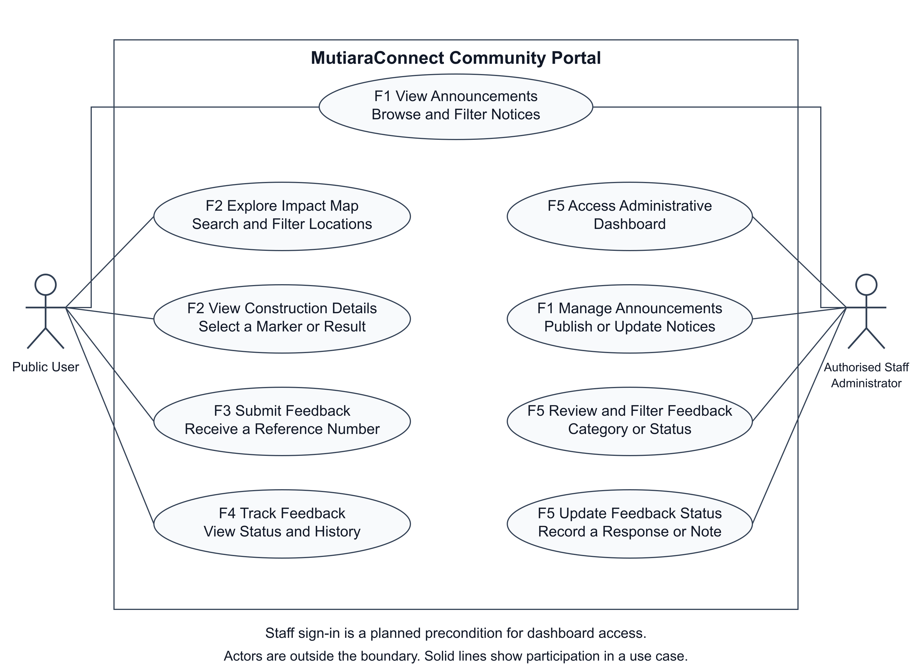
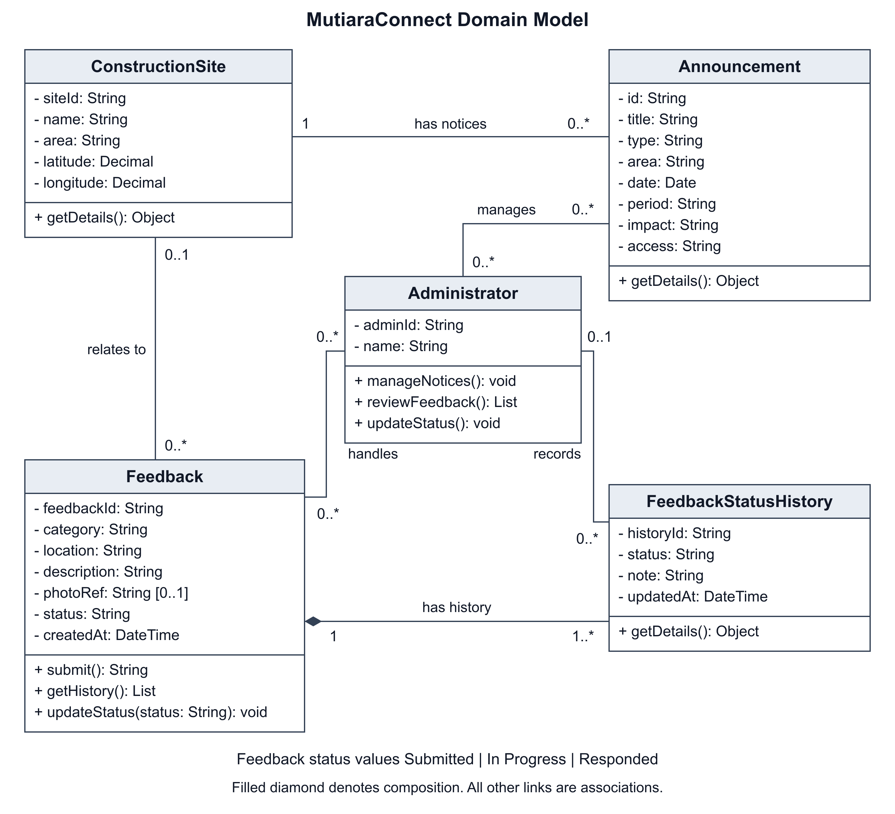
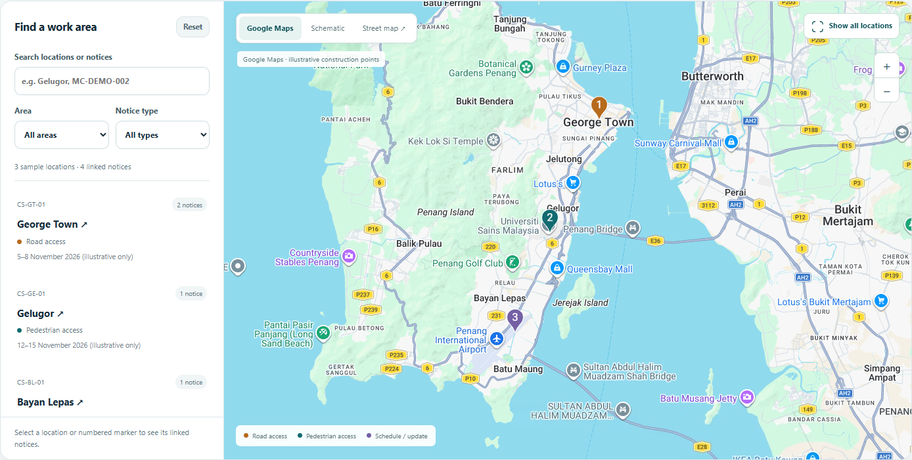

# MutiaraConnect System Models

The use case and class diagrams describe the five agreed MutiaraConnect functions: announcements, the construction impact map, feedback submission, feedback tracking and administration. They distinguish the proposed system design from the Part A front end simulation.

## Use Case Diagram

Figure 1  Public and authorised staff use cases across the five functions

Public User represents residents, commuters, business owners and visitors. The actor browses and filters announcements, explores the impact map, selects construction details, submits feedback and tracks a report. Authorised Staff, shown as Administrator, manage announcements, review reports and update statuses or responses. Staff can also read public announcements.

Both actors are outside the system boundary. Solid associations identify participation in a use case. Staff sign in is a precondition for the proposed dashboard; the front end does not provide production authentication. For F2, users search or filter locations, select a marker or result, inspect its impact and access information, and open the matching announcement.

## Class Diagram

Figure 2  Domain classes with association multiplicities and feedback history ownership

ConstructionSite identifies a mapped location. Each mapped Announcement belongs to one site, and a site can have zero or more announcements. The prototype links four shared announcements to three illustrative locations. Notice text, dates, impact and access information come from the existing announcement collection; the map does not maintain a second copy.

In the proposed feedback model, a Feedback record can refer to zero or one known site. It owns one or more FeedbackStatusHistory entries, shown by composition at the Feedback end. The initial entry records Submitted. Each history entry has zero or one Administrator so that the first submission can exist without a staff author.

Administrators can manage many announcements, handle many feedback records and record many history entries. Feedback states are Submitted, In Progress and Responded. A staff update changes the current status and adds a dated history note. These are domain responsibilities; the Part A simulation does not require persistent database classes.

## Map Prototype Evidence

The construction impact map links three illustrative locations to four shared sample announcements. Search, area and notice-type filters update the result cards and markers together. Selecting a location shows its work period, potential impact and access information. George Town links to two notices; Gelugor and Bayan Lepas link to one each.

With a valid local configuration and internet connection, the page opens Google Maps. Schematic provides an offline map, while Street map uses OpenStreetMap through Leaflet. All three views reuse the same notices and selection. Missing configuration or a detected online-map failure leaves the schematic usable. Construction points and notices are fictional examples, not verified work locations.

Read full announcement opens the selected notice in the existing detail page. View impact map returns with that notice selected. Reset clears the filters, and Show all locations restores the matching locations. The mobile layout places notice details below the map so the selected marker remains visible.

Figure 3  Google Maps shows three illustrative locations linked to four shared sample announcements

## Sources and credits

Google Maps JavaScript API: https://developers.google.com/maps/documentation/javascript/overview

Leaflet 1.9.4 API: https://leafletjs.com/reference.html

OpenStreetMap contributors and licence: https://www.openstreetmap.org/copyright

AI tools assisted with drafting and editing the report, preparing the system diagrams, implementing the map, and checking the prototype. The group reviews and remains responsible for the final submission.
