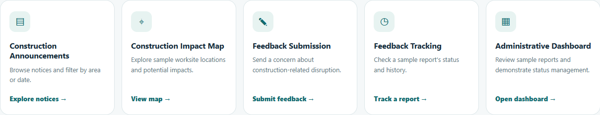
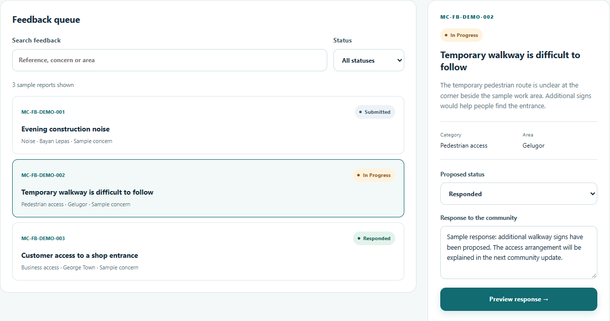
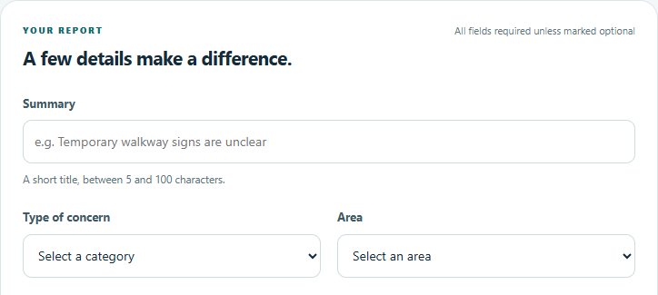
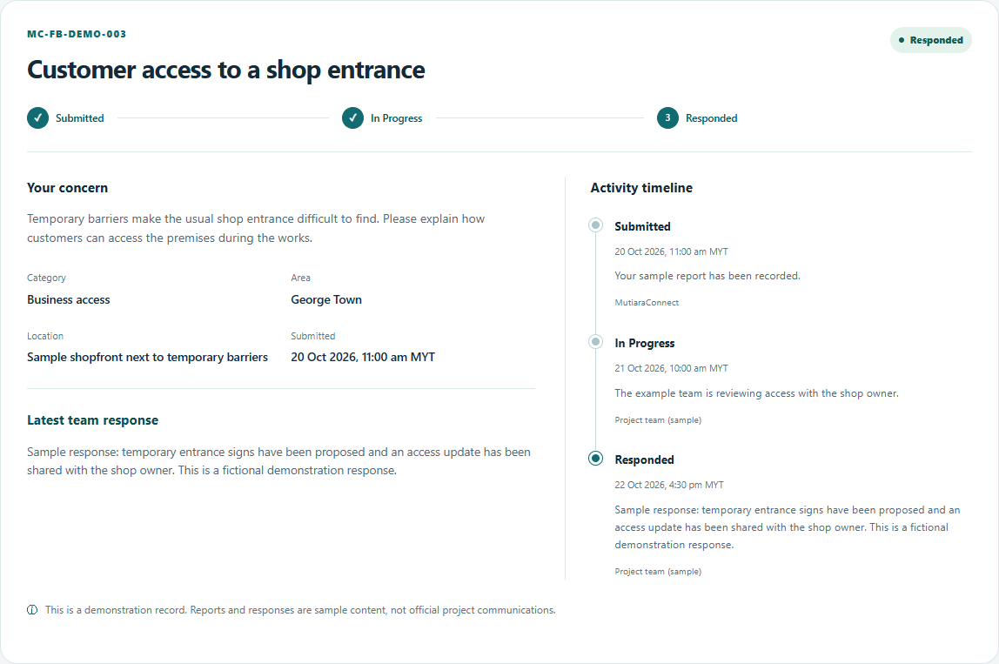

# MutiaraConnect Prototype Design

The MutiaraConnect interface connects construction information with a structured feedback process. Shared navigation provides access to announcements, the impact map, feedback submission and tracking. Teal actions, consistent cards and clear headings make these functions recognisable across desktop and mobile layouts. The public pages are interactive front-end screens; the staff dashboard is a separate design prototype.

**Figure PD1**  Homepage entry points for F1 announcements, F2 impact information, F3 submission, F4 tracking and F5 administration. The staff entry awaits integration.

## Public information and staff review

The announcement list supports keyword, area and notice-type filters. Each notice explains its period, potential impact and access information. The impact map and notice detail preserve the selected notice when users move between them. Homepage feature cards provide direct entry to the five planned functions (Figure PD1).

The proposed staff dashboard groups feedback by status and provides a searchable queue, report details and a response composer (Figure PD2). Staff can preview a proposed status and response in this isolated design. The main staff page and its connection to saved feedback remain for the administrator module to implement.

**Figure PD2**  Staff dashboard design prototype showing the sample queue and response composer. Preview actions do not update saved feedback.

## Feedback submission and tracking

The submission form records a summary, category, area, location and description (Figure PD3). Users may attach a JPG, PNG or WebP image of up to 2 MB. Field errors identify corrections before submission. A successful save opens a receipt with a unique reference and a direct link to the matching report.

**Figure PD3**  Submission form excerpt showing the summary, concern category and affected area. The remaining form collects location, description and an optional image.

The tracking screen shows the concern, current status and dated activity history (Figure PD4). The states Submitted, In Progress and Responded match the system model. An available team response appears alongside the timeline. Invalid or unknown references show an explanation instead of an unrelated report.

**Figure PD4**  Implemented tracking view for fictional report MC-FB-DEMO-003, showing Responded status, a team response and the activity history.

For Part A, new reports are stored in the same browser and can be retrieved after a reload. No real complaint is sent to a project team. The staff design preview does not modify these reports.
