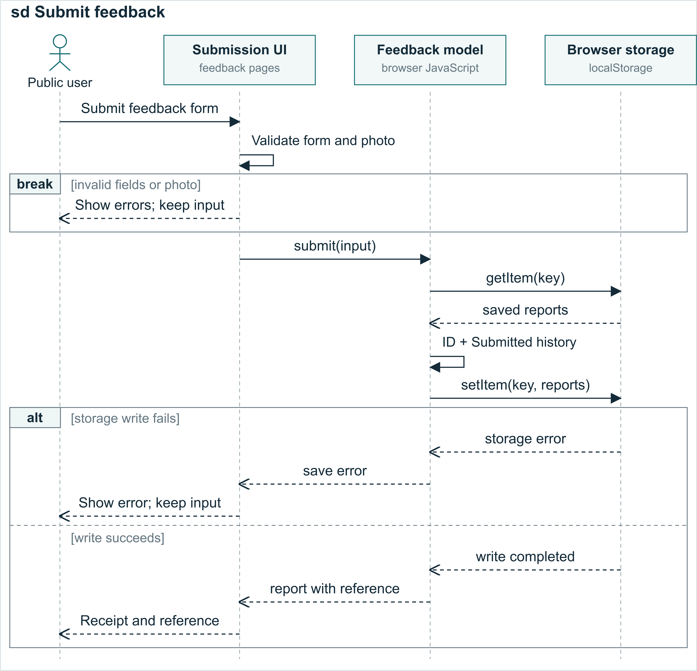
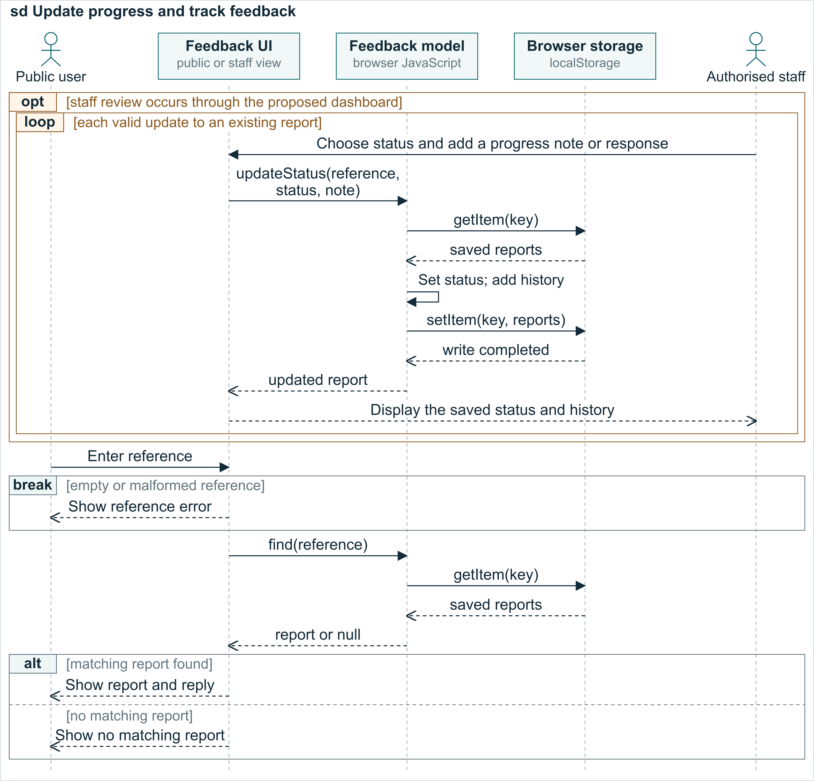

# Feedback Sequence Diagrams

Figure M3A  Feedback submission in the implemented Part A front end. The receipt follows a successful save in browser storage.

Figure M3A shows how a public user submits a concern. The Submission UI represents the feedback form and receipt pages. It checks the required fields and any optional photo. The break fragment ends this attempt when validation fails, keeping the input available for correction. Valid input is passed to the shared feedback model, which also checks its inputs.

The model reads saved reports, generates a unique reference and creates a Feedback record with status Submitted and its first FeedbackStatusHistory entry. It writes the updated collection to localStorage before returning the record. The alt fragment separates failed and successful writes: failure preserves the form and shows an error; success opens the receipt with the reference. Browser storage represents local prototype data, without a remote database.

## Review and tracking

Figure M3B  Proposed staff interface calls and implemented public tracking. The updateStatus API exists; the formal staff dashboard remains to be connected.

Figure M3B continues with an existing reference. The opt fragment allows staff review to be skipped. Through the proposed dashboard, authorised staff would call updateStatus(reference, status, note). The loop represents valid updates to an existing record with writable storage. Each update changes the current status and appends a dated history note. In the demonstration, updates can show In Progress followed by Responded; they do not happen automatically.

The public user can then query the reference. Empty or malformed references end the lookup through the break fragment. For valid input, find(reference) reads local records and includes the built-in samples. The alt fragment displays the matching report, status, history and any response, or a no-match message. The Feedback UI lifeline represents the appropriate public or staff view in each phase. Shared records require the same browser and origin; production staff authentication is outside this Part A simulation.

Notation reference: Object Management Group (2017), Unified Modeling Language 2.5.1, Chapter 17.

Reference URL: https://www.omg.org/spec/UML/2.5.1
